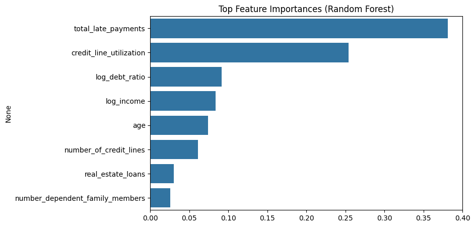

# loan-default-prediction

Predicting which borrowers will default on a loan from 72k credit records with a 7% default rate.
Moving from logistic regression to gradient-boosted trees raised **ROC-AUC from 0.746 to 0.835**
on the Kaggle private leaderboard. Past late payments and credit-line utilization drive most of the risk.



*DAN.IT Data Science course, mid-term project (in-class Kaggle competition).*

## Results

ROC-AUC (the competition metric). Validation = 20% stratified hold-out.

| Model | 5-fold CV | Validation | Kaggle public | **Kaggle private** |
|---|---|---|---|---|
| Logistic Regression (baseline) | 0.746 | 0.774 | 0.758 | 0.746 |
| Random Forest | 0.826 | 0.843 | 0.836 | 0.833 |
| **XGBoost** | **0.827** | **0.854** | **0.837** | **0.835** |

With class weighting (`scale_pos_weight` ≈ 13.4), XGBoost catches **77% of defaulters** on
validation, compared with 10% for the tuned Random Forest at the same 0.5 threshold without class weights. The cost
is precision, so the threshold is a business choice (see [recall vs threshold](results/recall_vs_threshold_xgb.png)).

## Approach

- **EDA:** 5–10% missing values per feature, heavily skewed income and debt ratio, strong class imbalance
  (so accuracy is useless and ROC-AUC, precision and recall are tracked instead).
- **Data cleaning:** numeric columns stored as text with decimal commas were converted back to numbers.
- **Feature engineering:** the three late-payment counts were almost perfectly correlated (0.98–0.99),
  so they were combined into `total_late_payments`. Income and debt ratio were log-transformed.
- **Models:** scikit-learn pipelines (median imputation + scaling) with `GridSearchCV` over
  stratified 5-fold CV for Logistic Regression, Random Forest and XGBoost.
- **Imbalance handling:** class weights and decision-threshold analysis (precision/recall/F1 trade-off).

## Repository structure

```
notebooks/
  01_eda.ipynb                  exploratory analysis and feature engineering
  02_logistic_regression.ipynb  baseline, tuning, threshold analysis, coefficients
  03_random_forest.ipynb        tuned Random Forest, feature importance
  04_xgboost.ipynb              tuned XGBoost with class weighting
results/                        figures and Kaggle score screenshot
data/README.md                  how to get the data
```

## How to run

```bash
git clone https://github.com/dariaproniakova/loan-default-prediction.git
cd loan-default-prediction
pip install -r requirements.txt
# put train.csv and test.csv in data/ (see data/README.md)
jupyter lab notebooks/
```

## What I learned / limitations

- On imbalanced data, a model can have a high ROC-AUC and still miss most positives at the default
  threshold. Choosing the threshold matters as much as choosing the model.
- Tree ensembles gave a big jump over the linear model (+0.09 AUC). XGBoost and Random Forest were
  close, so the non-linear interactions matter more than the specific ensemble method.
- Next steps: calibrate the probabilities, and choose the threshold from an explicit cost of a missed
  default versus a rejected good customer.

## License

Code: MIT. The dataset is not included in this repository.
